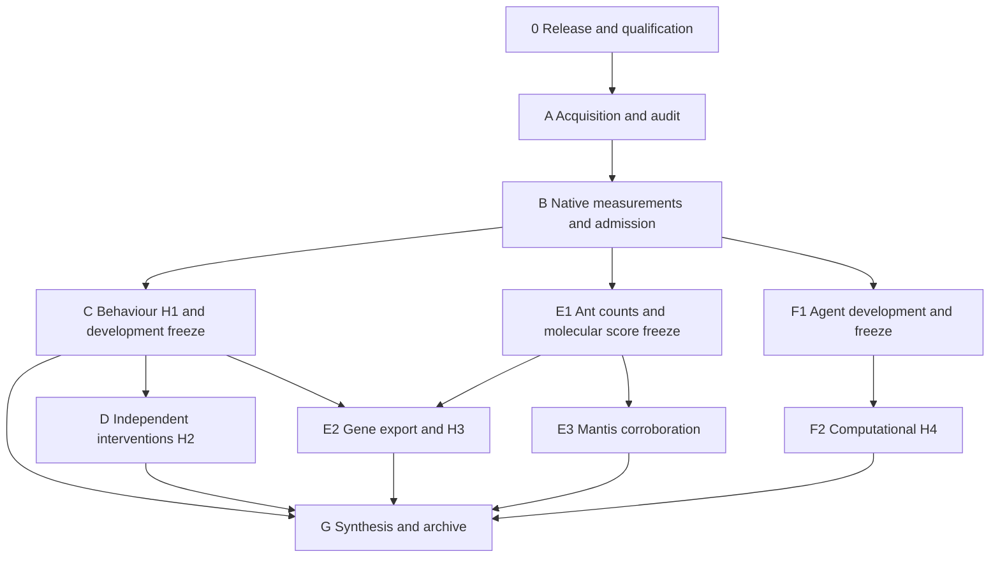

# Study roadmap

The study tests whether parasite-associated behavioural redirection is better explained by altered state transitions than by a uniform change in movement gain. It then tests independent intervention predictions, a frozen cross-species molecular association, and a separate computational redirection experiment. These four claims have different independent units and remain separate tests.

This document describes the durable study stages. The private deployment receipt and pipeline status record contain current native job identities, timestamps and queue states. Deployment, queue registration, completed computation and scientific support are separate milestones.

The [metadata and compute resolution extension](COMPUTE_AND_METADATA_RESOLUTION.md) documents the original-workbook audit and bounded behavioural/agent CPU measurements. Technical probe completion does not clear missing biological provenance or final scientific admission.

| Stage | Work | Evidence required to advance | Principal artifacts |
|---|---|---|---|
| 0. Release and qualification | Freeze source/configuration; qualify Python, CUDA, R, OrthoFinder and TransDecoder on allocated hardware | Successful native jobs and verified software fixtures/files | Release identity, qualification receipts, native accounting |
| A. Acquisition and audit | Download to personal Narval scratch; verify provider checksums; extract fly tracks; audit identities and annotations | Exact sources and validated adapters | Source manifest, verification, inventory, fly/intervention adapters |
| B. Feasibility measurements | Fixed low/high-depth ant pilot brains; full primary orthology; GPU timing for every agent architecture/task and CPU timing for the complete evaluation grid; full numerical behavioural/transfer work units | Current-release runtime, peak memory, storage and workload coverage; projected work fits limits | Benchmarks, storage snapshot, phase admission decisions |
| C. Behaviour — H1 | Duration-aware Student-t models and gain/transition/direction alternatives; grouped nested validation, recovery, identifiability, posterior checks, Bayesian comparison and 5/20-second sensitivity; independent mantis analyses | Primary exposure-clock provenance, complete diagnostics/holdouts and development-only freeze | Fits, diagnostic results, WP1 freeze, H1 inference, figure 02 |
| D. Interventions — H2 | Separate calibration/evaluation animals; retain shared controls; compare entry/persistence/speed predictions against gain and unrestricted models; hold out families | Original animal/condition/reagent/family mappings, valid uncertainty calibration and withheld comparisons | Covariance, calibration validation, family holdouts, H2 inference, figure 03 |
| E1. Molecular discovery/freeze | Process 60 fixed ant brains; discovery-only phase contrasts and separate refusal challenge; matched ant/fly orthology and outcome-independent descriptors; freeze reversible score | Count/design/QC audits and freeze before fly gene outcome export | Counts, sample crosswalk, phase contrasts, orthology, score freeze |
| E2. Molecular transfer — H3 | Validated unique fly gene effects and shared-control covariance; frozen ant score association with whole-family permutations and orthogroup/contrast uncertainty; nested learned prediction when coverage allows | Original reagent-to-gene/control mappings, unique genes, frozen family map, complete inference | Target provenance, gene covariance, predictions, H3 inference, figure 04 |
| E3. Mantis corroboration | Separate integer count model, actual TransDecoder peptides and exploratory three-species orthology | Valid sample/count and transcript/gene mappings; native tool completion | Mantis audit, ORF coverage, separate three-species mapping |
| F1. Agent development | Three tasks and four architecture cells including feedforward; complete development seed/rate roster; freeze learning rate, perturbations and matching | All 180 development fits/checkpoints and prospective evaluation roster | Development checkpoints, frozen computational protocol |
| F2. Computational experiment — H4 | 240 final policies; complete strength/rank grid, norm/policy-divergence matching, competence, restoration, controls and held-out transfer | Independent final seeds, complete outcomes and actual qualification/matching | Final checkpoints, CPU trials, response curves, H4 inference, figure 05 |
| G. Synthesis/archive | Joint H1/H2/H3 Holm family and separate H4 grid correction; six figures and claim-to-evidence index; durable archive | Completed or explicitly unresolved decisions, source hashes and visual figure review before publication | Report, figure inputs/renderings, reviewed release manifest |

## Queue and advancement

The managed initial plan registers qualification, source checks, bounded native pilots/benchmarks and four sequential finite Slurm controller segments. The controller window is approximately 24 days. It records stage status, reconciles native accounting, refreshes personal scratch measurements, and submits later finite phases when dependencies, source readiness and measured resource admission are satisfied. Failed or ambiguous submissions remain preserved for repair and are never blindly replayed.

Fixed study limits are 64 concurrent CPUs, one A100 40GB GPU, 20,000 CPU core-hours, 400 GPU-hours and 6TB of study scratch with a 2TB personal reserve. Admitted phases use measured allocations. The controller checks combined prospective concurrency across existing jobs and new plans, and reserves allocation bounds for every unfinished registered job member, including pending arrays. Forecasts above a limit require a documented resource or work-splitting amendment.

Source transfers and Slurm waits are separate processes. A release update does not restart the RNA download. Previously transferred raw files are consumed only against the same frozen source manifest and independent integrity checks.

## Interpretation and source boundaries

The converted fly archive has an author-defined processed 3Hz clock. This supports recording-relative chronology but does not establish exact continuous hours since exposure. Primary exposure-modulated H1 requires per-experiment exposure offsets with source provenance. A recording-relative technical timing benchmark is explicitly labeled and cannot become H1 evidence.

Survivors in exposed fly cohorts remain exposed. Missing unexposed controls, exposure times and intervention identities are never supplied by guessing. Pooled matrices and death-aligned summaries cannot replace chronological individual tracks or original control/reagent/gene/family crosswalks.

The agent primary experiment is computational. Behavioural state-model parameters do not identify signs of neural weight changes. A biological bridge remains conditional on separately validated, prospectively frozen evidence. Numerically unavailable episodes remain in the planned roster with explicit diagnostics and null endpoints; they cannot be discarded, imputed, or accepted as complete timing or H4 evidence.

Mantis endpoint contradictions remain in the canonical deposited observations. A declared parser amendment separates a conditional fit of mutually consistent rows from two all-row endpoint sensitivity interpretations. Computational completion of these diagnostics does not reconcile author annotations or establish confirmatory readiness.

Negative effects and failed model discrimination are scientific outcomes when required diagnostics are complete. Missing data/diagnostics, insufficient competence and underidentified models remain explicit limitations. Completed results, selected checkpoints, final count tables, source and evidence are copied to an immutable personal-project archive with verified file hashes and native project-quota checks. The bounded archive excludes raw sequencing and large processing intermediates. Publication readiness additionally requires actual visual review of figures.
