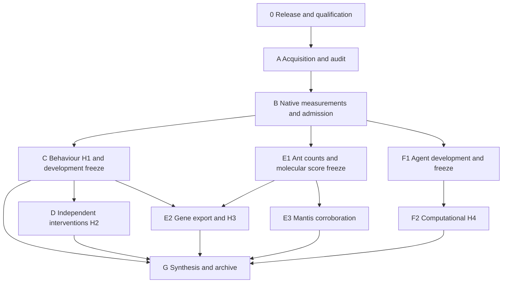

# Study roadmap

The study tests whether parasite-associated behavioural redirection is better explained by altered state transitions than by a uniform change in movement gain. It then tests independent intervention predictions, a frozen cross-species molecular association, and a separate computational redirection experiment. These four claims have different independent units and remain separate tests.

This document describes the durable study stages. The private deployment receipt and pipeline status record contain current native job identities, timestamps and queue states. Deployment, queue registration, completed computation and scientific support are separate milestones.

The user's subsequent [A–F execution amendment](EXECUTION_AMENDMENT_AF.md) authorizes removal of cumulative CPU/GPU caps through an explicit source-bound operational policy, initially allowing 256 concurrent CPUs and four one-GPU jobs. Historical fixed-budget statements below describe the original configuration. Scientific gates, storage limits and completed primary evidence remain separately preserved. The amendment also records whole-cohort profiling, a prospective float64 agent evaluator and additional public-data acquisition routes.

The [metadata and compute resolution extension](COMPUTE_AND_METADATA_RESOLUTION.md) documents the original-workbook audit and bounded behavioural/agent CPU measurements. Technical probe completion does not clear missing biological provenance or final scientific admission.

Current execution position, 21 October 2026: the archive-aware technical source passed complete native qualification (1,826 tests, no failures, errors or skips). The paired agent precision canary finished all 52 conditions and 1,664 trial rows. Three original final policies have completed their full training; one policy failed before training during a registry publication race. The revised controller repair passed 100 operational and 42 migration tests on Narval. Its one-time activation started after a renewed exact storage census and preserves the three healthy checkpoints and the original failure. This is early F2 execution; the 240-policy experiment remains incomplete.

The faster-heartbeat whole-fold profiler reached the source data and exposed undefined validation scores for recordings without observations after the original 600-second warm-up. A separately reviewed numerical-prefix job has started to retain every recording and null score while measuring one unchanged full-fold gradient, clip and Adam update. Full behavioural fitting and original H1 admission remain pending. See the [prospective coverage amendment](C_RECORDING_RELATIVE_ELIGIBILITY_AMENDMENT_20261021.md); its changed scientific criterion has not been executed.

All six files of the public viral-activity DAM cohort are provider-verified directly on Narval, and their source/clock audit completed. A separately checksum-verified public ethoscope database passed its read-only native schema audit, including 96 prerequisite tests. A complete 30,121,971-byte VTL tracking member was acquired directly on Narval using 5,326,525 bytes of exact HTTP ranges; deposited ZIP CRC passed and a first-acquisition SHA256 was recorded. Its structural audit has completed; control mappings and timebase still require qualification. These routes support separately specified analyses. They do not recover the original parasite cohort's missing exposure or animal/reagent crosswalks. **Never request data from authors**; no author message was sent. See the [execution amendment](EXECUTION_AMENDMENT_AF.md) for the evidence and remaining gates.

At the 21:39 UTC check, the fresh exact-size census had completed: 94,984 study files and 1,138,317,866,984 bytes. The controller activation and full-cohort numerical prefix had started. The whole-record first-order comparison is registered after positive prefix completion. VTL structural audit 6700647 completed successfully after 45 wrapper, 68 acquisition and 40 parser tests. It establishes the deposited syntax and documentation boundaries; biological identities, observed/imputed masks, physical units and gene/control mappings remain unqualified.

The [prospective public-cohort protocols](PROSPECTIVE_SECONDARY_ANALYSES_20261021.md) now define separate count-prediction, host-response portability and processing-output questions. Their metadata inventory has 28 passing synthetic tests and a deterministic source replay. DAM has 131 coded channels across three author experiments, including 28 controls shared across comparisons. All 119 repeated date–machine–ROI keys in the full Ethoscope metadata have conflicting labels across two figures; those figures cannot be pooled as independent animals. These are design facts, not fitted effects. A separately labelled numerical appendix remains a draft requiring review, assay qualification, implementation, recovery and measured cost.

The official VTL stock workbook has also been downloaded directly to Narval through NCBI's current public AWS distribution and matches its provider MD5. Its 267,375 bytes are bound by SHA256 `f8fb6db82687d2dad58215df15283a8d8640acec6c722d0966d9f6f5ca183cb8`. Workbook acquisition does not establish any control or reagent join; its metadata audit is a separate prerequisite. No author contact or new local raw-data relay was used.

Production compaction remains unactivated. Integration review found that the cost ledger stores allocation costs rather than owner/account fields; archive qualification must join it to a separate strict native ownership query. New realistic parser/ledger fixtures and a separately qualified corrected source are required. Original condition files, selected native proof files and all previous qualifications remain preserved, and no prospective file saving is credited before measured, validated compaction.

Verified milestone, 21 October 2026: the 12-cell agent CPU cost pack and its native aggregation are complete. Stage B still requires behavioural workload measurements and complete resource admission. Stage F2 remains gated by the frozen scientific completion rules and the uncovered final training/analysis costs.

At the 15:09 UTC check, both behavioural quota retries and both aggregations were complete. Behavioural operator coverage is 38/39 cells: the five-second AR probe reached its bounded worker deadline. The conservative partial optimizer projection exceeds the CPU cap, so Stage B requires a workload/cost review before advancement. No benchmark jobs remain active or queued at that timestamp.

The subsequent [AR repair and cost review](COMPUTE_AND_METADATA_RESOLUTION.md#autoregressive-repair-and-cost-review-21-october) restores the primary one-thread runtime setting for a separately registered AR retry and independently audits workload arithmetic. The corrected historical scenario remains far above 20,000 CPU core-hours; it is not observed expenditure or a guaranteed full-fit runtime. Stage B remains open, and complete scientific analysis is not admitted. Finite repair, software qualification and cost-audit jobs preserve the fixed cap and all scientific gates.

At the 16:23 UTC closing check, AR retry 6678131, aggregation 6678132 and final cost audit 6678315 were all COMPLETED/0:0. The technical operator pack is now complete: **39/39 cells and 468/468 operations**. New software qualification 6675953 passed **1,504 tests** with zero failures, errors or skips. The reviewed historical optimizer scenario remains approximately 7.732 billion CPU core-hours, with full optimizer/inference/output work still incompletely measured. Resolving this benchmark gap therefore does not close Stage B's whole-study budget admission or the scientific provenance gates.

| Stage | Work | Evidence required to advance | Principal artifacts |
|---|---|---|---|
| 0. Release and qualification | Freeze source/configuration; qualify Python, CUDA, R, OrthoFinder and TransDecoder on allocated hardware | Successful native jobs and verified software fixtures/files | Release identity, qualification receipts, native accounting |
| A. Acquisition and audit | Download to personal Narval scratch; verify provider checksums; extract fly tracks; audit identities and annotations | Exact sources and validated adapters | Source manifest, verification, inventory, fly/intervention adapters |
| B. Feasibility measurements | Fixed low/high-depth ant pilot brains; full primary orthology; GPU timing for every agent architecture/task and CPU timing for the complete evaluation grid; full numerical behavioural/transfer work units | Current-release runtime, peak memory, storage and workload coverage; projected work fits limits | Benchmarks, storage snapshot, phase admission decisions |
| C. Behaviour — H1 | Duration-aware Student-t models and gain/transition/direction alternatives; grouped nested validation, recovery, identifiability, posterior checks, Bayesian comparison and 5/20-second sensitivity; independent mantis analyses | Primary exposure-clock provenance, complete diagnostics/holdouts and development-only freeze | Fits, diagnostic results, WP1 freeze, H1 inference, figure 02 |
| D. Interventions — H2 | Separate calibration/evaluation animals; retain shared controls; compare entry/persistence/speed predictions against gain and unrestricted models; hold out families | Original animal/condition/reagent/family mappings, valid uncertainty calibration and withheld comparisons | Covariance, calibration validation, family holdouts, H2 inference, figure 03 |
| E1. Molecular discovery/freeze | Process 60 fixed ant brains; discovery-only phase contrasts and separate refusal challenge; matched ant/fly orthology and outcome-independent descriptors; freeze reversible score | Count/design/QC audits and freeze before fly gene outcome export | Counts, sample crosswalk, phase contrasts, orthology, score freeze |
| E2. Molecular transfer — H3 | Validated unique fly gene effects and shared-control covariance; frozen ant score association with whole-family permutations and orthogroup/contrast uncertainty; nested learned prediction when coverage allows | Original reagent-to-gene/control mappings, unique genes, frozen family map, complete inference | Target provenance, gene covariance, predictions, H3 inference, figure 04 |
| E3. Mantis corroboration | Separate integer count model, actual TransDecoder peptides and exploratory three-species orthology | Valid sample/count and transcript/gene mappings; native tool completion | Mantis audit, ORF coverage, separate three-species mapping |
| F1. Agent development | Three tasks and four architecture cells including feedforward; complete development seed/rate roster; freeze learning rate, perturbations and matching | All 180 development fits/checkpoints and prospective evaluation roster | Development checkpoints, frozen computational protocol |
| F2. Computational experiment — H4 | 240 final policies; complete strength/rank grid, norm/policy-divergence matching, competence, restoration, controls and held-out transfer | Independent final seeds, complete outcomes and actual qualification/matching | Final checkpoints, CPU trials, response curves, H4 inference, figure 05 |
| G. Synthesis/archive | Joint H1/H2/H3 Holm family and separate H4 grid correction; six figures and claim-to-evidence index; durable archive | Completed or explicitly unresolved decisions, source hashes and visual figure review before publication | Report, figure inputs/renderings, reviewed release manifest |

## Queue and advancement

The managed initial plan registers qualification, source checks, bounded native pilots/benchmarks and four sequential finite Slurm controller segments. The controller window is approximately 24 days. It records stage status, reconciles native accounting, refreshes personal scratch measurements, and submits later finite phases when dependencies, source readiness and measured resource admission are satisfied. Failed or ambiguous submissions remain preserved for repair and are never blindly replayed.

The original configuration specifies 64 concurrent CPUs, one A100 40GB GPU, 20,000 CPU core-hours, 400 GPU-hours and 6TB of study scratch with a 2TB personal reserve. The explicit operational policy in the A–F amendment supersedes its CPU/GPU caps only for policy-bound callers. Admitted phases use measured allocations. Admission checks combined prospective concurrency across existing jobs and new plans, and reserves allocation bounds for every unfinished registered job member, including pending arrays.

Source transfers and Slurm waits are separate processes. A release update does not restart the RNA download. Previously transferred raw files are consumed only against the same frozen source manifest and independent integrity checks.

## Interpretation and source boundaries

The converted fly archive has an author-defined processed 3Hz clock. This supports recording-relative chronology but does not establish exact continuous hours since exposure. Primary exposure-modulated H1 requires per-experiment exposure offsets with source provenance. A recording-relative technical timing benchmark is explicitly labeled and cannot become H1 evidence.

Survivors in exposed fly cohorts remain exposed. Missing unexposed controls, exposure times and intervention identities are never supplied by guessing. Pooled matrices and death-aligned summaries cannot replace chronological individual tracks or original control/reagent/gene/family crosswalks.

The agent primary experiment is computational. Behavioural state-model parameters do not identify signs of neural weight changes. A biological bridge remains conditional on separately validated, prospectively frozen evidence. Numerically unavailable episodes remain in the planned roster with explicit diagnostics and null endpoints; they cannot be discarded, imputed, or accepted as complete timing or H4 evidence.

Mantis endpoint contradictions remain in the canonical deposited observations. A declared parser amendment separates a conditional fit of mutually consistent rows from two all-row endpoint sensitivity interpretations. Computational completion of these diagnostics does not reconcile author annotations or establish confirmatory readiness.

Negative effects and failed model discrimination are scientific outcomes when required diagnostics are complete. Missing data/diagnostics, insufficient competence and underidentified models remain explicit limitations. Completed results, selected checkpoints, final count tables, source and evidence are copied to an immutable personal-project archive with verified file hashes and native project-quota checks. The bounded archive excludes raw sequencing and large processing intermediates. Publication readiness additionally requires actual visual review of figures.
