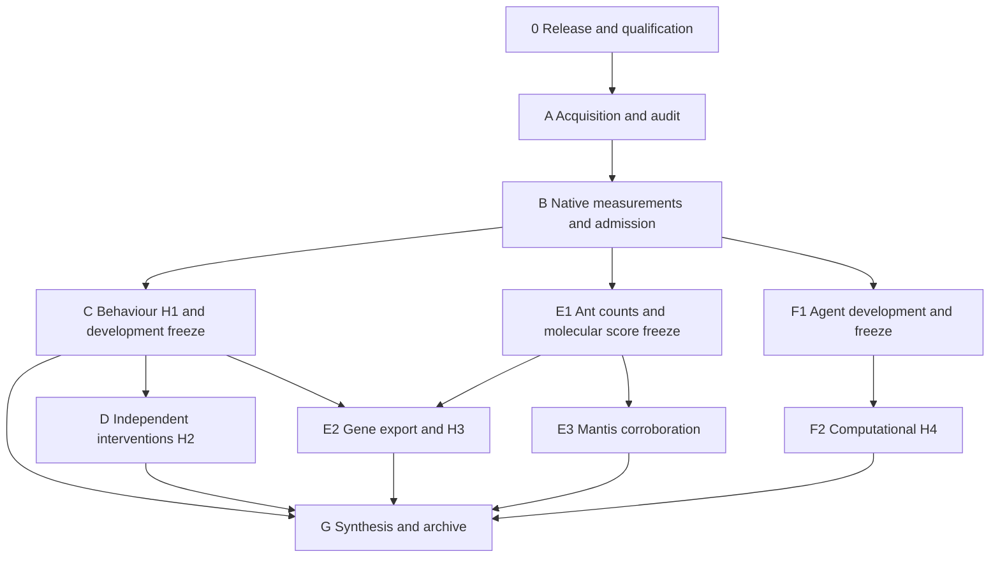

# Study roadmap

The study tests whether parasite-associated behavioural redirection is better explained by altered state transitions than by a uniform change in movement gain. It then tests independent intervention predictions, a frozen cross-species molecular association, and a separate computational redirection experiment. These four claims have different independent units and remain separate tests.

This document describes the durable study stages. The private deployment receipt and pipeline status record contain current native job identities, timestamps and queue states. Deployment, queue registration, completed computation and scientific support are separate milestones.

The user's subsequent [A–F execution amendment](EXECUTION_AMENDMENT_AF.md) authorizes removal of cumulative CPU/GPU caps through an explicit source-bound operational policy, initially allowing 256 concurrent CPUs and four one-GPU jobs. Historical fixed-budget statements below describe the original configuration. Scientific gates, storage limits and completed primary evidence remain separately preserved. The amendment also records whole-cohort profiling, a prospective float64 agent evaluator and additional public-data acquisition routes.

The [metadata and compute resolution extension](COMPUTE_AND_METADATA_RESOLUTION.md) documents the original-workbook audit and bounded behavioural/agent CPU measurements. Technical probe completion does not clear missing biological provenance or final scientific admission.

Latest verified checkpoint:

At **27 October 2026, 07:41 CET**, canonical progress records **126 completed trainings and 122 completed policies**. All 11 jobs previously held after the release-acknowledgement failure completed 0:0, and all four prior v4 controller slots completed 0:0. A new sequential chain using the same qualified code, **7495474–7495477**, has been released: the first is pending in the scheduler with no reported reason, and the other three are waiting on dependencies. Four training jobs and the primary controller are waiting for resources reserved for maintenance. Narval lists an all-node reservation from 27 October 10:00 CET to 3 November 10:00 CET; scheduler reservations can change.

Census slot 16 failed with exit code 126 after an I/O error when starting Python on compute node **nc10901**; slot 17 is queued. Python works on the login node, but a compute-node fix has not been established. Storage admission and scientific gates remain unchanged. Scientific conclusions and the complete study remain pending.

Earlier repair checkpoint, **26 October 2026, 11:28 CET**: job **7352510** completed 0:0 in 73 seconds, but its lost release acknowledgement left the following 11 jobs held. The exact original held allocation, plan/script/ledger, canonical completed receipt and fresh final accounting were verified before updating only its release journal. Original bytes were archived and the compressed campaign state remained unchanged. The recovered batch has **3 completed assembly jobs**, **1 completed CPU evaluation job**, **3 running CPU evaluation jobs** and **4 running GPU training jobs**. All 11 original jobs were released without resubmission.

At that checkpoint, controller **7373985 was RUNNING** with source-verified startup; successors **7373992/7374031/7374040** are registered and released with sequential success dependencies. The qualified replacement retired only controllers **7340344/7340363/7340394/7340447**, after waiting for the active registration transaction and preserving its state. No scientific worker was cancelled. The administrative handoff initially rejected Slurm's `CANCELLED by ...` text; its continuation normalized that owned terminal-state label and resumed from the saved retirement record without repeating cancellation or submission.

Qualification **7371890 completed 0:0** in 25 seconds with **144 native tests**; the full local operational closure passes **225 tests**. The existing coordination component now resolves a lost release acknowledgement using positive final accounting when a successful job is no longer observable through the live-job interface. It verifies the original issued-release journal, exact job ID, held script/name/owner/resources and actual successful final allocation. It updates only the release acknowledgement; original scientific receipt validation, numerical routines, provider freshness and deadline reserves remain unchanged. Missing, conflicting or unsuccessful evidence cannot manufacture an acknowledgement or cause a repeated submission.

At that checkpoint, canonical revision **559** recognized **101 completed trainings and 94 completed policies**, with no scientific repair flags. Newly finished workers then awaited normal canonical reconciliation. The primary pipeline awaited maintenance availability. The complete A–F study and final scientific inference remain incomplete. See the [coordination source and execution record](../operations/20261025/agent-coordination-repair-v1/README.md).

The repaired census has completed five exact sweeps with positive native completion. The original six-hour freshness rules remain unchanged. The complete-cohort behavioural comparison **6997524 completed 0:0** for **1,107 records and 7,828,183 bins**. Objective values matched exactly, and all **18 gradient groups** passed tolerance; maximum absolute difference was **5.55e-17**. This is a complete training-fold first-order comparison at frozen initialization, with **zero optimizer updates**. Complete optimization, convergence, sampling and scientific fit qualification remain pending.

The earlier controlled handoff **7095413 completed 0:0** and released all eight replacements after checkpoint preservation and positive retirement. It was not repeated. At the earlier checkpoint, the first primary replacement **7046213** was queued pending resources reserved for maintenance, with its successors awaiting dependencies. Original H1-H3 provenance limitations and scientific admission gates remain unresolved. The A-F study is not complete.

Earlier verified repair checkpoint, **23 October 2026, 15:03 CEST (13:03 UTC)**: the census repair and all original cancelled-job resubmissions are complete. Census **6864491 completed 0:0** in **46 minutes**, measuring **168,046 study files and 1,141,177,952,379 logical bytes**. Replacements **6865503/6865525/6865619/6865697 completed 0:0** and behavioural prefix **6865674 is running**. F2 handoff **6865706 completed 0:0**, with **6868746/6868747/6868750/6868753** still pending scheduler priority/dependencies. Corrected primary handoff **6872985 completed 0:0** after **172 passing native contracts** and real emitted-policy validation; it released **6873101/6873102/6873105/6873107**. First primary controller **6873101 is running**, has its resource lease, and successfully consumed the complete fresh census; its source-preservation proof confirms the original pipeline logic. The three successors are pending dependencies. A completed scientific tick or resumed RNA stage is not yet established; the captured pipeline status still named the older controller. The earlier v3 prestart failure and all original/unused controller histories remain preserved. See the [native repair and startup evidence](../operations/20261023/primary-handoff-native-reconciliation-v1/README.md).

Earlier verified repair checkpoint, **23 October 2026, 13:25 CEST (11:25 UTC)**: census **6864491 completed 0:0** in about **46 minutes**, measuring **168,046 files and 1,141,177,952,379 logical bytes**. All five cancelled jobs were replaced: registry qualifications **6865503/6865525**, targeted recovery **6865619**, and archive qualification **6865697** completed successfully; behavioural prefix **6865674 is running**. The targeted derivative advanced the campaign to revision **406** and queued four F2 controllers. External-census F2 handoff **6865706** and corrected primary handoff **6868176 are running**, after their **91 and 125 native contracts** passed. Primary policy qualification **6866457** separately passed all **202 native cases**. The earlier primary handoff failed before changing controllers because of a path-confinement bug; the v2 fix is narrowly hash-bound and all original evidence remains preserved. Final handoff receipts and healthy external-census controller execution remain pending. See the [restored queue and primary repair evidence](../operations/20261023/census-restored-native-queue-and-primary-repair-v1/README.md).

Earlier verified repair checkpoint, **23 October 2026, 11:56 CEST (09:56 UTC)**: corrected native qualification **6863966 completed 0:0** after all **757 cases across 13 suites** and the real filesystem canary passed. The finite restoration coordinator **6864084 is running**. At the recorded check its seven child registrations had not yet published their ledgers, so the production census, replacement dependent jobs and controller handoff are still pending. The preserved campaign remains revision 405, with its compressed bytes unchanged. See the [census and controller resumption evidence](../operations/20261023/census-and-controller-resumption-v1/README.md).

The repair separates the bounded streaming census from controller execution. It reserves 8 CPUs, 64 GB and six hours per census slot, preserves the original strict six-hour quota clocks, and makes the new F2 policy wait for a complete, finalized provider instead of launching the old slow scan. The original failed census, all five cancelled jobs and earlier unsuccessful qualification attempts remain preserved. Separately, main controller **6632164 failed at 07:44:53 UTC** when its fresh Lustre quota query exceeded 30 seconds; its source-bound operational replacement is still under construction. Neither queued repair nor software qualification establishes a resumed scientific computation or a completed A–F study.

Latest repair source checkpoint, **23 October 2026, 10:29 CEST (08:29 UTC)**: new native qualification **6859130** is registered and pending priority. The reviewed closure contains **757 local test cases** and a bounded streaming census, repeatable provider and controller wait policy. The first qualification failed before collection because its child environment removed an Alliance Python dependency; the revised qualifier preserves and verifies those paths. A completed census, fresh replacement registrations and healthy replacement controllers remain pending. See the [streaming repair source](../operations/20261023/census-streaming-repair-v1/README.md).

Latest verified execution, **23 October 2026, 08:42 CEST (06:42 UTC)**: census **6811498 failed at 03:20:45 CEST**, with the preserved `Finite census deadline reached` error. Its last **75,000 files** are partial. All five dependent jobs (**6819399, 6822432, 6822568, 6822730, 6824584**) were cancelled at 03:25:56 CEST with no start time and zero runtime. The targeted repair did not execute; no replacement F2 controller ledger, activation receipt or retry journal was created. Current compressed state bytes still exactly match revision 405: **76 completed trainings and 67 completed policies**. The separate main controller 6632164 is running, which does not establish replacement-controller health. A corrected, separately qualified census and fresh dependent registrations are required. See the [live failure evidence](../operations/20261023/census-deadline-status-check/README.md). This progress check submitted no jobs and changed no scientific state.

Earlier verified execution, **23 October 2026, 00:59 CEST (22 October 22:59 UTC)**: census **6811498** is running with **38,000 files** and **4,641,325,981 logical bytes** reported, still partial. Registry qualification **6822432**, targeted recovery/activation **6822568**, behavioural first-update probe **6822730**, and archive reader qualification **6824584** are registered and pending their source-bound afterok dependencies. All four exact plan/ledger/script bindings were verified on Narval 3. The last verified campaign snapshot remains revision 405 with **76 complete trainings and 67 complete policies**; no new healthy replacement controller or completed full study is claimed. The [native archive-test registration](../operations/20261023/native-archive-test-registration/README.md) confirms request 406's actual Slurm identity while retaining the earlier unconfirmed checkpoint.

At **23 October 2026, 00:30 CEST (22 October 22:30 UTC)**, fresh qualification **6822432** and the corrected behavioural first-update probe **6822730** are actually registered, pending afterok census **6811498**. Targeted recovery/activation **6822568** is pending afterok qualification 6822432. Exact plan/ledger/script hashes and issued dependencies were revalidated on Narval 3. The latest census progress is 23,000 files and 4,117,067,852 logical bytes; this is a partial scan, not admission evidence or a final count. A successful scan still retains its original quota capture clock and strict six-hour freshness. Latest reviewed Git 9c701a8 is verified in personal scratch with unchanged public source f047. See the [native-registration evidence](../operations/20261023/queued-prestart-repair/README.md). No new derivative state or healthy replacement controller is claimed yet.

Further verified progress at **23 October, 00:49 CEST (22 October 22:49 UTC)**: census 6811498 has advanced to **32,000 files** and **4,277,602,935 logical bytes**, still partial. Its actual allocation ends at 03:23:17 CEST; the wrapper reserves a finalization margin and preserves the original quota clock. The queued jobs remain dependent on successful census completion. A compatible archive reader and its new qualifier have passed **136 + 72 local tests** with independent source/roster review. Native request 406 is submitted but its Slurm identity is not yet confirmed. This source only tests the reader closure; actual packing, a separate finalizer, native consumer integration and handover remain required. See the [archive reader qualification capsule](../operations/20261023/archive-reader-v3-qualification/README.md).

Earlier verified execution, **22 October 2026, 23:40 CEST (21:40 UTC)**: allocated diagnostic job **6807825** completed successfully and read the preserved revision 405 state: **76 completed trainings and 67 completed policies**. Three later native attempts failed before computation, during registry admission: evaluations for cell 73 and training for cells 76 and 77. Their original failures, plans, journals and empty output cases remain preserved. The earlier controller is canceled for maintenance and all three later F2 controllers have failed. The campaign has not resumed and the 240-policy experiment and H4 inference remain incomplete.

Fresh exact-census job **6811498** is running after passing its 30 registry and 44 census prerequisites. Its progress is a partial scan, not a completed storage measurement. The corrected whole-cohort prefix and private registry qualification still require actual recorded Slurm registration/completion evidence. A separate reviewed repair targets only the three proven prestart failures, preserves every unrelated job and the original evaluation wave, and requires complete native qualification and a lock-bound state comparison before activation. The new producer must also publish genuine completed accounting evidence before successor controllers validate it.

The [three-target repair capsule](../operations/20261023/prestart-three-continuation/README.md) preserves **369 passing local tests**. Qualification must pass **364 native tests** before any state change. The [healthy-client continuation](../operations/20261023/healthy-narval-route/README.md) records the later failures of requests 384/385 on Narval 2, exact source verification through Narval 3, and fresh requests 394/395 for qualification/activation. Behavioural request 399 preserves the same 98-test prefix source and checks the earlier request 376's absent publication/output before submission. These remain transport requests until actual Slurm identities are confirmed. At **23 October, 00:16 CEST**, census **6811498** was running with 19,000 files scanned; qualification **6819399** was pending afterok that census. No new state derivative or healthy replacement controller is claimed.

The earlier controller-maintenance reconciliation completed successfully as native job **6757565**, after all 34 contracts passed. It preserved the original state, proved that four intentions had no native job or submission artifacts, removed only their pending references, and let the unchanged dispatcher regenerate exactly those intentions. Existing jobs and condition evidence were retained. Native stock audit **6752621**, archive pack/finalizer qualification **6753241**, and Figure01 adapter qualification **6753455** all completed successfully. Figure01 qualification passed 74 wrapper and 123 adapter tests; it did not acquire the 36-database cohort.

Exact census **6753750** completed with **131,762 study files and 1,139,659,470,298 bytes**. A later original census recorded 139,573 files and 1,140,181,661,342 bytes with a 13:18 UTC capture clock; that clock is historical and is never refreshed by relabelling it. Further census and registry repairs require their own live completion evidence.

Behavioural prefix **6757358** passed its 81 startup contracts but failed before numerical work because the preserved public probe helper allows at most 7,200 seconds. A fresh version has **98 passing local tests**, an explicit eight-hour allocation and a bounded 27,900-second worker, while preprocessing, the full gradient/update, and validation functions remain exact AST copies. It does not alter the old public helper or turn an unfinished prefix into a complete fit. A new complete-registry read retains every original record and changes only its total bound from 180 to 900 seconds; 103 operational tests and 32 qualification-wrapper tests pass locally. Replacement registration requests remain unconfirmed until actual Slurm IDs are recorded.

The immediate sequence is: finish the fresh exact census; run the corrected prefix and native registry qualification; then apply the separately qualified three-target state derivative and activate source-bound controller successors. The allocated failed-child diagnosis is complete. Actual archive production/consumer integration and direct acquisition of the independently specified full Figure01 cohort remain separate work. No original exposure or reagent crosswalk is inferred from those alternatives, and no author is contacted.

Historical checkpoint, 22 October 2026, 00:20 CEST (21 October 22:20 UTC): the corrected source passed complete native qualification, job 6703313, with **1,889 tests and zero failures, errors or skips**, followed by successful native completion. The paired agent precision canary had already finished all 52 conditions and 1,664 trial rows. Controller activation completed successfully and released four finite segments. The active first segment reports **six completed final trainings**, including the previously failed policy's separate retry, with further training and evaluation running. Original failures and all three previously healthy checkpoints remain preserved. This is early F2 execution; the 240-policy experiment remains incomplete.

The faster-heartbeat whole-fold profiler reached the source data and exposed undefined validation scores for recordings without observations after the original 600-second warm-up. A separately reviewed numerical-prefix job has started to retain every recording and null score while measuring one unchanged full-fold gradient, clip and Adam update. Full behavioural fitting and original H1 admission remain pending. See the [prospective coverage amendment](C_RECORDING_RELATIVE_ELIGIBILITY_AMENDMENT_20261021.md); its changed scientific criterion has not been executed.

All six files of the public viral-activity DAM cohort are provider-verified directly on Narval, and their source/clock audit completed. A separately checksum-verified public ethoscope database passed its read-only native schema audit, including 96 prerequisite tests. A complete 30,121,971-byte VTL tracking member was acquired directly on Narval using 5,326,525 bytes of exact HTTP ranges; deposited ZIP CRC passed and a first-acquisition SHA256 was recorded. Its structural audit has completed; control mappings and timebase still require qualification. These routes support separately specified analyses. They do not recover the original parasite cohort's missing exposure or animal/reagent crosswalks. **Never request data from authors**; no author message was sent. See the [execution amendment](EXECUTION_AMENDMENT_AF.md) for the evidence and remaining gates.

At the 21:39 UTC check, the fresh exact-size census had completed: 94,984 study files and 1,138,317,866,984 bytes. The controller activation and full-cohort numerical prefix had started. The whole-record first-order comparison is registered after positive prefix completion. VTL structural audit 6700647 completed successfully after 45 wrapper, 68 acquisition and 40 parser tests. It establishes the deposited syntax and documentation boundaries; biological identities, observed/imputed masks, physical units and gene/control mappings remain unqualified.

The [prospective public-cohort protocols](PROSPECTIVE_SECONDARY_ANALYSES_20261021.md) now define separate count-prediction, host-response portability and processing-output questions. Their metadata inventory has 28 passing synthetic tests and a deterministic source replay. DAM has 131 coded channels across three author experiments, including 28 controls shared across comparisons. All 119 repeated date–machine–ROI keys in the full Ethoscope metadata have conflicting labels across two figures; those figures cannot be pooled as independent animals. These are design facts, not fitted effects. A separately labelled numerical appendix remains a draft requiring review, assay qualification, implementation, recovery and measured cost.

The official VTL stock workbook has also been downloaded directly to Narval through NCBI's current public AWS distribution and matches its provider MD5. Its 267,375 bytes are bound by SHA256 `f8fb6db82687d2dad58215df15283a8d8640acec6c722d0966d9f6f5ca183cb8`. Workbook acquisition does not establish any control or reagent join; its metadata audit is a separate prerequisite. No author contact or new local raw-data relay was used.

Later verified progress, 21 October 22:38 UTC: the active F2 state reported seven completed trainings. Census audit 6704313 completed successfully after all 38 native prerequisite tests. It classified all 94,984 preserved entries: 2,942 candidate paths, 83,825 protected files and 8,217 unresolved files. Candidate-path classification establishes no archive eligibility or file saving; no original was removed.

Stock audit 6704402 passed its 47 native prerequisite tests, then refused an opaque printer-settings ZIP member before producing an actual-source report. A source-specific retry permits only that exact 220-byte advertised printer member, leaves its binary payload unopened, and retains the original refusal of other binaries and macros. Its 76 synthetic cases pass locally and independently; native retry submission and completion remain pending. The failed audit remains preserved.

The interrupted private archive qualification staged its four immutable source files but created no plan, submission intent, ledger, job or result at the 22:56 UTC reconciliation. Its transport deadline was shorter than the finite registration-lock wait. A new foreground continuation must recheck the unchanged sources and absence of publication under the original mutex before registering that logical job once. The later login connection could not start a shell; a fresh interactive connection is needed before any submission is reported as queued. The last live F2 and behavioural states above are historical observations, not a current health claim.

The independent Ethoscope Figure01 acquisition plan retains all 370 ROI metadata rows and all 36 source databases, including six compressed members crossing split-archive boundaries. A deterministic 34-test manifest builder reproduces the source selection without outcome inspection. The new bounded acquisition adapter remains under review and requires complete native qualification before actual transfers. Its raw-data downloads will run directly on personal Narval scratch. These independent bacterial host-response data do not fill the original parasite cohort's exposure or reagent crosswalks.

Production compaction remains unactivated. Integration review found that the cost ledger stores allocation costs rather than owner/account fields. The corrected source independently joins a strict native ownership query to the unchanged positive cost proof; its realistic parser/ledger fixtures are included in the successful 1,889-test qualification. A complete private pack/finalizer qualification, actual positive producer and consumer integration are still required. Original condition files, selected native proof files and all previous qualifications remain preserved, and no prospective file saving is credited before measured, validated compaction.

Verified milestone, 21 October 2026: the 12-cell agent CPU cost pack and its native aggregation are complete. Stage B still requires behavioural workload measurements and complete resource admission. Stage F2 remains gated by the frozen scientific completion rules and the uncovered final training/analysis costs.

At the 15:09 UTC check, both behavioural quota retries and both aggregations were complete. Behavioural operator coverage is 38/39 cells: the five-second AR probe reached its bounded worker deadline. The conservative partial optimizer projection exceeds the CPU cap, so Stage B requires a workload/cost review before advancement. No benchmark jobs remain active or queued at that timestamp.

The subsequent [AR repair and cost review](COMPUTE_AND_METADATA_RESOLUTION.md#autoregressive-repair-and-cost-review-21-october) restores the primary one-thread runtime setting for a separately registered AR retry and independently audits workload arithmetic. The corrected historical scenario remains far above 20,000 CPU core-hours; it is not observed expenditure or a guaranteed full-fit runtime. Stage B remains open, and complete scientific analysis is not admitted. Finite repair, software qualification and cost-audit jobs preserve the fixed cap and all scientific gates.

At the 16:23 UTC closing check, AR retry 6678131, aggregation 6678132 and final cost audit 6678315 were all COMPLETED/0:0. The technical operator pack is now complete: **39/39 cells and 468/468 operations**. New software qualification 6675953 passed **1,504 tests** with zero failures, errors or skips. The reviewed historical optimizer scenario remains approximately 7.732 billion CPU core-hours, with full optimizer/inference/output work still incompletely measured. Resolving this benchmark gap therefore does not close Stage B's whole-study budget admission or the scientific provenance gates.

| Stage | Work | Evidence required to advance | Principal artifacts |
|---|---|---|---|
| 0. Release and qualification | Freeze source/configuration; qualify Python, CUDA, R, OrthoFinder and TransDecoder on allocated hardware | Successful native jobs and verified software fixtures/files | Release identity, qualification receipts, native accounting |
| A. Acquisition and audit | Download to personal Narval scratch; verify provider checksums; extract fly tracks; audit identities and annotations | Exact sources and validated adapters | Source manifest, verification, inventory, fly/intervention adapters |
| B. Feasibility measurements | Fixed low/high-depth ant pilot brains; full primary orthology; GPU timing for every agent architecture/task and CPU timing for the complete evaluation grid; full numerical behavioural/transfer work units | Current-release runtime, peak memory, storage and workload coverage; projected work fits limits | Benchmarks, storage snapshot, phase admission decisions |
| C. Behaviour — H1 | Duration-aware Student-t models and gain/transition/direction alternatives; grouped nested validation, recovery, identifiability, posterior checks, Bayesian comparison and 5/20-second sensitivity; independent mantis analyses | Primary exposure-clock provenance, complete diagnostics/holdouts and development-only freeze | Fits, diagnostic results, WP1 freeze, H1 inference, figure 02 |
| D. Interventions — H2 | Separate calibration/evaluation animals; retain shared controls; compare entry/persistence/speed predictions against gain and unrestricted models; hold out families | Original animal/condition/reagent/family mappings, valid uncertainty calibration and withheld comparisons | Covariance, calibration validation, family holdouts, H2 inference, figure 03 |
| E1. Molecular discovery/freeze | Process 60 fixed ant brains; discovery-only phase contrasts and separate refusal challenge; matched ant/fly orthology and outcome-independent descriptors; freeze reversible score | Count/design/QC audits and freeze before fly gene outcome export | Counts, sample crosswalk, phase contrasts, orthology, score freeze |
| E2. Molecular transfer — H3 | Validated unique fly gene effects and shared-control covariance; frozen ant score association with whole-family permutations and orthogroup/contrast uncertainty; nested learned prediction when coverage allows | Original reagent-to-gene/control mappings, unique genes, frozen family map, complete inference | Target provenance, gene covariance, predictions, H3 inference, figure 04 |
| E3. Mantis corroboration | Separate integer count model, actual TransDecoder peptides and exploratory three-species orthology | Valid sample/count and transcript/gene mappings; native tool completion | Mantis audit, ORF coverage, separate three-species mapping |
| F1. Agent development | Three tasks and four architecture cells including feedforward; complete development seed/rate roster; freeze learning rate, perturbations and matching | All 180 development fits/checkpoints and prospective evaluation roster | Development checkpoints, frozen computational protocol |
| F2. Computational experiment — H4 | 240 final policies; complete strength/rank grid, norm/policy-divergence matching, competence, restoration, controls and held-out transfer | Independent final seeds, complete outcomes and actual qualification/matching | Final checkpoints, CPU trials, response curves, H4 inference, figure 05 |
| G. Synthesis/archive | Joint H1/H2/H3 Holm family and separate H4 grid correction; six figures and claim-to-evidence index; durable archive | Completed or explicitly unresolved decisions, source hashes and visual figure review before publication | Report, figure inputs/renderings, reviewed release manifest |

## Queue and advancement

The managed initial plan registers qualification, source checks, bounded native pilots/benchmarks and four sequential finite Slurm controller segments. The controller window is approximately 24 days. It records stage status, reconciles native accounting, refreshes personal scratch measurements, and submits later finite phases when dependencies, source readiness and measured resource admission are satisfied. Failed or ambiguous submissions remain preserved for repair and are never blindly replayed.

The original configuration specifies 64 concurrent CPUs, one A100 40GB GPU, 20,000 CPU core-hours, 400 GPU-hours and 6TB of study scratch with a 2TB personal reserve. The explicit operational policy in the A–F amendment supersedes its CPU/GPU caps only for policy-bound callers. Admitted phases use measured allocations. Admission checks combined prospective concurrency across existing jobs and new plans, and reserves allocation bounds for every unfinished registered job member, including pending arrays.

Source transfers and Slurm waits are separate processes. A release update does not restart the RNA download. Previously transferred raw files are consumed only against the same frozen source manifest and independent integrity checks.

## Interpretation and source boundaries

The converted fly archive has an author-defined processed 3Hz clock. This supports recording-relative chronology but does not establish exact continuous hours since exposure. Primary exposure-modulated H1 requires per-experiment exposure offsets with source provenance. A recording-relative technical timing benchmark is explicitly labeled and cannot become H1 evidence.

Survivors in exposed fly cohorts remain exposed. Missing unexposed controls, exposure times and intervention identities are never supplied by guessing. Pooled matrices and death-aligned summaries cannot replace chronological individual tracks or original control/reagent/gene/family crosswalks.

The agent primary experiment is computational. Behavioural state-model parameters do not identify signs of neural weight changes. A biological bridge remains conditional on separately validated, prospectively frozen evidence. Numerically unavailable episodes remain in the planned roster with explicit diagnostics and null endpoints; they cannot be discarded, imputed, or accepted as complete timing or H4 evidence.

Mantis endpoint contradictions remain in the canonical deposited observations. A declared parser amendment separates a conditional fit of mutually consistent rows from two all-row endpoint sensitivity interpretations. Computational completion of these diagnostics does not reconcile author annotations or establish confirmatory readiness.

Negative effects and failed model discrimination are scientific outcomes when required diagnostics are complete. Missing data/diagnostics, insufficient competence and underidentified models remain explicit limitations. Completed results, selected checkpoints, final count tables, source and evidence are copied to an immutable personal-project archive with verified file hashes and native project-quota checks. The bounded archive excludes raw sequencing and large processing intermediates. Publication readiness additionally requires actual visual review of figures.
